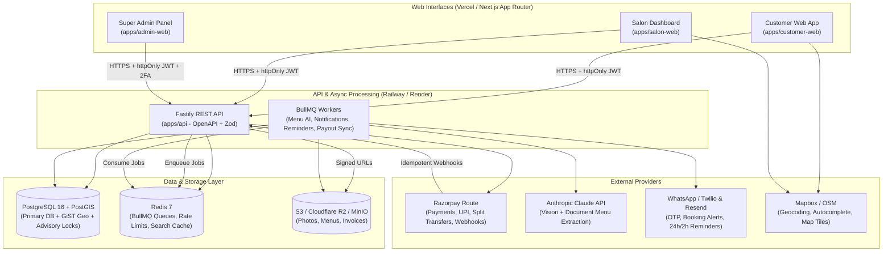

# SalonBridge — System Architecture & Technical Design (Phase 1)

> **Status:** Phase 1 Deliverable (Awaiting User Approval before Phase 2 Scaffolding)  
> **Target Market:** India-first (INR, GST, DPDP Act, `Asia/Kolkata` default) with multi-currency/timezone-ready schema.

---

## 1. Confirmed Assumptions (from Phase 0)

| Area | Decision |
| :--- | :--- |
| **Geography & Compliance** | India-first (INR, UPI, GST-ready invoices, DPDP Act), UTC storage with salon-local timezone display (`Asia/Kolkata` default). |
| **Payments & Splits** | **Automated marketplace splits** via **Razorpay Route** (with provider-agnostic interface for Stripe Connect later). Commission on "Pay at Salon" bookings tracked via a salon commission ledger. |
| **Cancellation & Refunds** | **Platform-enforced standard policy** (e.g., free cancellation ≥ 4h before slot, partial/no refund within 4h, 100% refund on salon-initiated cancellation or verified no-show dispute). |
| **Backend & ORM** | **Fastify + TypeScript + Zod + Drizzle ORM** (`fastify-type-provider-zod` + `@fastify/swagger` for OpenAPI 3.1). |
| **Maps & Geocoding** | **Mapbox / OpenStreetMap (Nominatim)** behind a thin geocoding/map abstraction, with Google Places easily swappable. |
| **AI Menu Extraction** | **Anthropic Claude API** (vision + document understanding) with strict Zod validation, token/cost logging per job, and plan-based monthly import quotas. |
| **Auth & Notifications** | **WhatsApp-first** OTP & transactional notifications (Twilio WhatsApp / Meta Cloud API) + **Resend** for email + local console/mock adapter for dev. |
| **Super Admin Security** | Mandatory **TOTP 2FA** (`otplib` + encrypted backup codes) + optional IP allow-list middleware + immutable audit log. |
| **Tenant Model** | **1 Owner = 1 Salon** initially (simpler onboarding), using `salon_members` for role-based staff/owner access within a salon. |
| **Hosting & Team** | Small team (1–3 devs), low-burn cloud: **Vercel** (3 Next.js apps) + **Railway/Render** (Fastify API, BullMQ Worker, PostgreSQL+PostGIS, Redis) + **Cloudflare R2 / S3**. |

---

## 2. System Architecture Diagram



---

## 3. Monorepo Structure (Turborepo + pnpm)

```text
salonbridge/
├── apps/
│   ├── customer-web/          # Next.js App Router (Public discovery, compare, booking)
│   ├── salon-web/             # Next.js App Router (Salon onboarding, AI menu, calendar, CRM)
│   ├── admin-web/             # Next.js App Router (Super Admin, 2FA, approvals, analytics)
│   └── api/                   # Fastify + Drizzle + BullMQ (REST API + Background Workers)
├── packages/
│   ├── ui/                    # Shared shadcn/ui components, Tailwind preset, theme tokens
│   ├── types/                 # Shared Zod schemas, DTOs, enums, error codes
│   ├── db/                    # Drizzle schema, PostGIS helpers, migrations, seed scripts
│   ├── api-client/            # Typed OpenAPI client generated from apps/api swagger.json
│   └── config/                # Shared ESLint, TypeScript (strict), Vitest, Prettier configs
├── docker/
│   └── postgres/              # Init scripts (enable postgis, uuid-ossp, pg_trgm)
├── docs/
│   └── ARCHITECTURE.md        # This document
├── docker-compose.yml         # Local dev: Postgres+PostGIS, Redis, MinIO
├── turbo.json                 # Build, lint, test, typecheck pipeline
├── pnpm-workspace.yaml
└── .github/workflows/ci.yml   # Lint, typecheck, unit/integration tests
```

---

## 4. Tech Decisions & Trade-Offs

| Decision | Why We Chose It | Trade-Off & Mitigation |
| :--- | :--- | :--- |
| **Fastify + Drizzle ORM** over NestJS + Prisma | Fastify is lightweight, low-overhead, and pairs natively with `zod` (`fastify-type-provider-zod`) for single-source-of-truth validation + OpenAPI generation. Drizzle gives first-class SQL control for PostGIS (`ST_DWithin`, `ST_Distance`), GiST indexes, and `pg_advisory_xact_lock` without Prisma `Unsupported` workarounds. | Less built-in boilerplate than NestJS DI. Mitigated by enforcing a strict `routes -> services -> repositories` module structure and shared Fastify plugins (auth, RBAC, tenant context, error handler). |
| **Razorpay Route (Marketplace Splits)** over Collect-Then-Payout | Automates split settlements directly to salon linked accounts, reducing platform escrow/reconciliation burden and GST-on-gross-GMV risk. | Requires salons to complete Razorpay Route linked-account KYC before accepting online payments. Mitigated by allowing "Pay at Salon" during onboarding while KYC is pending. |
| **Platform-Enforced Cancellation Policy** | Eliminates customer confusion across salons, simplifies refund state machines, and reduces disputes. | Less flexibility for boutique salons. Mitigated by keeping policy parameters in `platform_configs` so tiered rules can be introduced later without schema changes. |
| **WhatsApp-First OTP & Alerts** | Highest open/delivery rate in India compared to SMS/email; supports rich booking confirmations and 24h/2h reminders. | Meta/Twilio template approval lead time. Mitigated by a provider-agnostic `NotificationPort` with an Email (Resend) fallback and local console mock adapter. |
| **1 Owner = 1 Salon** | Faster onboarding UX and simpler tenant scoping (`salon_id` on every scoped table). | Multi-branch chains need separate logins initially. Mitigated by using a `salon_members` join table, making future multi-salon switching additive. |
| **PostgreSQL + PostGIS + Redis** | Single relational source of truth for ACID bookings + geospatial queries (`GEOGRAPHY(Point, 4326)`), plus Redis for ephemeral BullMQ jobs, rate limiting, and hot search caching. | Spatial queries at scale can become CPU-bound. Mitigated by GiST spatial indexes, bounding-box pre-filtering, and short-TTL Redis caching for popular city/area searches. |

---

## 5. Core Database Schema (ERD)

All timestamps are stored in **UTC** (`timestamptz`). All salon-scoped tables include `salon_id` for strict tenant isolation.

```mermaid
erDiagram
    users ||--o{ user_roles : has
    roles ||--o{ user_roles : assigned_to
    users ||--o{ auth_sessions : owns
    users ||--o{ salon_members : belongs_to
    salons ||--o{ salon_members : employs
    salons ||--o{ salon_photos : has
    salons ||--o{ salon_hours : operates
    salons ||--o{ staff : has
    staff ||--o{ staff_services : performs
    services ||--o{ staff_services : offered_by
    staff ||--o{ staff_schedules : works
    staff ||--o{ staff_leaves : takes
    salons ||--o{ service_categories : organizes
    service_categories ||--o{ services : contains
    services ||--o{ service_variants : has
    salons ||--o{ menu_import_jobs : uploads
    menu_import_jobs ||--o{ menu_import_items : extracts
    salons ||--o{ menu_versions : snapshots

    users ||--o{ bookings : books
    salons ||--o{ bookings : receives
    bookings ||--o{ booking_items : includes
    services ||--o{ booking_items : booked_as
    staff ||--o{ booking_items : assigned_to
    salons ||--o{ slot_holds : locks
    bookings ||--o{ payments : paid_via
    payments ||--o{ refunds : refunded_via
    salons ||--o{ payouts : receives
    bookings ||--o| reviews : reviewed_in
    users ||--o{ favorites : saves
    salons ||--o{ favorites : saved_by

    plans ||--o{ subscriptions : defines
    salons ||--o{ subscriptions : subscribes
    salons ||--o{ coupons : offers
    users ||--o{ notifications : receives
    users ||--o{ audit_logs : triggers

    users {
        uuid id PK
        string phone UK
        string email UK
        string google_id UK
        string full_name
        string avatar_url
        string totp_secret_enc
        boolean totp_enabled
        string status "active|blocked"
        timestamptz created_at
    }

    salons {
        uuid id PK
        string slug UK
        string name
        string status "pending|approved|rejected|suspended"
        geography location "PostGIS Point 4326"
        string address_line
        string city
        string state
        string pincode
        string timezone "Asia/Kolkata"
        string gstin
        string razorpay_account_id
        numeric avg_rating
        int review_count
        boolean is_featured
        jsonb amenities
        timestamptz created_at
    }

    bookings {
        uuid id PK
        string booking_code UK
        uuid customer_id FK
        uuid salon_id FK
        string status "pending_payment|confirmed|in_progress|completed|cancelled|no_show"
        string payment_mode "online|pay_at_salon"
        timestamptz start_at
        timestamptz end_at
        int total_amount_paise
        int discount_paise
        int commission_paise
        string cancellation_reason
        timestamptz created_at
    }

    slot_holds {
        uuid id PK
        uuid salon_id FK
        uuid staff_id FK
        uuid customer_id FK
        timestamptz start_at
        timestamptz end_at
        timestamptz expires_at
    }

    menu_import_jobs {
        uuid id PK
        uuid salon_id FK
        uuid uploaded_by FK
        string source_type "image|pdf|csv|xlsx|docx|text"
        string file_key
        string status "queued|processing|review_ready|published|failed"
        int input_tokens
        int output_tokens
        int cost_paise
        jsonb error_details
        timestamptz created_at
    }
```



### Key Indexes & Constraints
- **Geospatial:** `CREATE INDEX idx_salons_location_gist ON salons USING GIST (location);`
- **Full-Text / Fuzzy Search:** `pg_trgm` GIN index on `salons.name`, `salons.city`, `services.name`.
- **Booking & Slot Hold Conflict Prevention:** Composite B-Tree indexes on `(salon_id, staff_id, start_at, end_at)` + `expires_at` for `slot_holds`.
- **Tenant Scoping:** Every salon-owned table indexed with `salon_id` as the leading column.

---

## 6. API Surface Overview (`/api/v1`)

All endpoints return a consistent envelope `{ data, meta }` or `{ error: { code, message, details, requestId } }`.

| Group | Prefix | Auth & Scope | Key Endpoints |
| :--- | :--- | :--- | :--- |
| **Auth** | `/api/v1/auth` | Public / JWT | `POST /otp/send`, `POST /otp/verify`, `POST /google`, `POST /refresh`, `POST /logout`, `POST /admin/2fa/verify` |
| **Discovery (Customer)** | `/api/v1/public` | Public (Rate-limited) | `GET /salons/search` (lat/lng, radius, filters, sort), `GET /salons/:slug`, `GET /salons/compare?ids=...`, `GET /categories`, `GET /salons/:id/availability` |
| **Booking (Customer)** | `/api/v1/customer` | `ROLE_CUSTOMER` | `POST /holds`, `DELETE /holds/:id`, `POST /bookings`, `GET /bookings`, `POST /bookings/:id/reschedule`, `POST /bookings/:id/cancel`, `POST /bookings/:id/reviews`, `POST /favorites/:salonId` |
| **Salon Dashboard** | `/api/v1/salon` | `ROLE_SALON_*` + Tenant Guard | `POST /onboarding`, `PATCH /profile`, `CRUD /staff`, `CRUD /services`, `GET/PATCH /bookings`, `POST /bookings/walk-in`, `GET /analytics`, `GET /payouts` |
| **AI Menu Pipeline** | `/api/v1/salon/menu-imports` | `ROLE_SALON_OWNER\|MANAGER` | `POST /upload-url`, `POST /` (create job), `GET /:jobId`, `PATCH /:jobId/items`, `POST /:jobId/publish`, `GET /versions`, `POST /versions/:v/rollback` |
| **Super Admin** | `/api/v1/admin` | `ROLE_SUPER_ADMIN` + 2FA | `GET/PATCH /salons/:id/status`, `GET/PATCH /users/:id`, `GET /bookings`, `POST /refunds`, `CRUD /plans`, `CRUD /coupons`, `GET /analytics`, `GET /ai-imports`, `POST /impersonate/:salonId`, `GET /audit-logs` |
| **Webhooks & System** | `/api/v1/webhooks`, `/health` | Signature Verified / Public | `POST /webhooks/razorpay`, `POST /webhooks/whatsapp`, `GET /health/live`, `GET /health/ready` |

---

## 7. Security, Concurrency & Multi-Tenancy

1. **Double-Booking Prevention (Concurrency):**
   - Step 1: Checkout acquires a `slot_hold` (TTL = 7 minutes) inside a DB transaction using `pg_advisory_xact_lock(hashtext(staff_id || date))`.
   - Step 2: Confirming a booking re-acquires the advisory lock, verifies no overlapping `confirmed`/`in_progress` booking or active `slot_hold` (belonging to another user) exists, inserts the booking, and deletes the hold atomically.
   - A BullMQ repeatable job purges expired `slot_holds` every 60 seconds.
2. **Multi-Tenancy Isolation:**
   - Every `/api/v1/salon/*` request passes through `requireSalonMember` middleware, which resolves `salonId` from the authenticated membership (never trusting a client-supplied `salon_id` body/query param without verifying membership).
   - Repository methods require `salonId` as an explicit first parameter.
3. **File Upload Security:**
   - Direct-to-S3/R2 presigned `PUT` URLs with strict `Content-Length` (max 10MB) and `Content-Type` allow-list.
   - Worker verifies magic-byte MIME type before processing (preventing spoofed extensions).
4. **Auth & OWASP:**
   - Short-lived JWT access token (15m) + rotating refresh token (30d) in `httpOnly`, `Secure`, `SameSite=Lax` cookies.
   - Redis-backed rate limiting (stricter on `/auth/otp/*`, `/search`, and `/menu-imports`).
   - Helmet security headers, strict CORS allow-list for the 3 frontend origins, Zod validation on all inputs.

---

## 8. Risk Register & Mitigations

| Risk | Severity | Mitigation |
| :--- | :--- | :--- |
| **AI Menu Extraction Hallucinations / Bad OCR** | High | Strict Claude JSON schema + Zod validation + mandatory human-in-the-loop Review Screen with confidence badges + one-click version rollback. |
| **Double-Booking Race Conditions** | High | Transactional `pg_advisory_xact_lock` per `(staff_id, date)` + `slot_holds` with 7-min TTL + unit/concurrency integration tests. |
| **Razorpay Route KYC Delays Blocking Salon Launch** | Medium | Allow approved salons to accept "Pay at Salon" bookings immediately while Razorpay Route KYC is in progress. |
| **WhatsApp Template Rejection / Delivery Failure** | Medium | Pre-submit standard utility templates early; fallback to Email (Resend) for OTP/confirmations if WhatsApp fails. |
| **PostGIS Search Latency on Cold Cache** | Medium | GiST index on `location`, `ST_DWithin` bounding box, pagination, and 30s–60s Redis caching for common city/lat-lng grid buckets. |
| **AI Token Cost Spikes** | Medium | Enforce plan-based monthly import quotas, compress/resize oversized images before sending to Claude, and log per-salon token costs. |
| **Tenant Data Leakage** | Critical | `salonId` derived strictly from verified JWT/membership, mandatory `salonId` parameter in all tenant repositories, and automated RBAC/tenant isolation tests. |
| **Webhook Replay / Out-of-Order Events** | Medium | Verify Razorpay HMAC signature, store `event_id` idempotency key in DB, and enforce valid payment state transitions. |

---

## 9. Phase 1 Definition of Done & Phase 2 Preview

- [x] Confirmed Phase 0 assumptions reflected in architecture.
- [x] System architecture diagram, monorepo layout, and tech trade-offs documented.
- [x] Full normalized ERD and key indexing strategy defined.
- [x] REST API surface, concurrency model, security, and risk register documented.

**Next (Phase 2 — Project Scaffolding):**
Initialize `pnpm` + Turborepo monorepo, `docker-compose.yml` (Postgres+PostGIS, Redis, MinIO), `packages/config`, `packages/types`, `packages/db` (Drizzle schema + initial migration), `apps/api` (Fastify + Swagger + Auth/RBAC + Health checks), and skeleton Next.js apps (`customer-web`, `salon-web`, `admin-web`).

